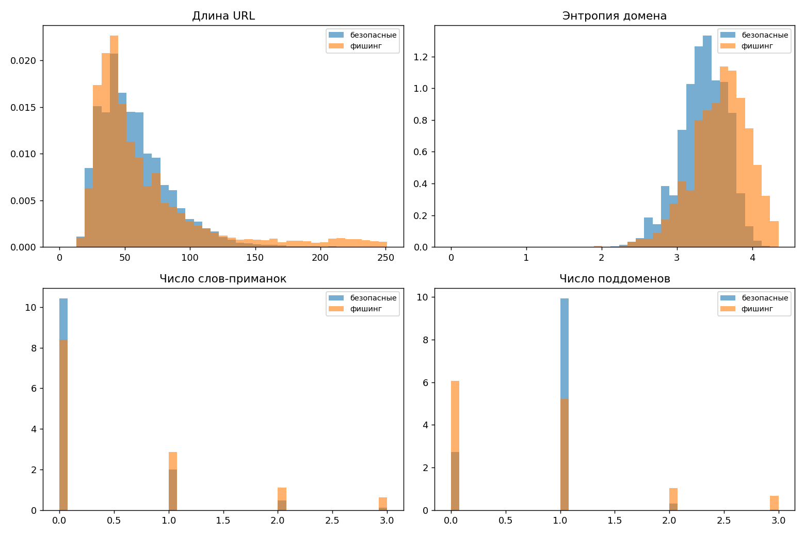
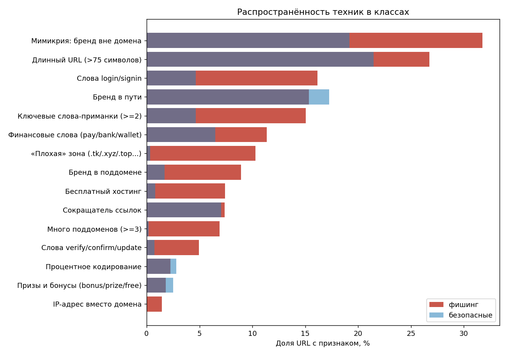
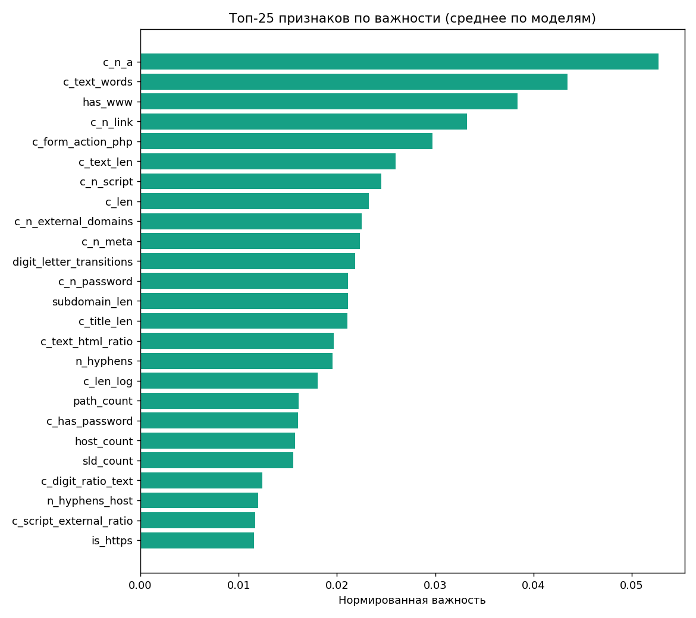
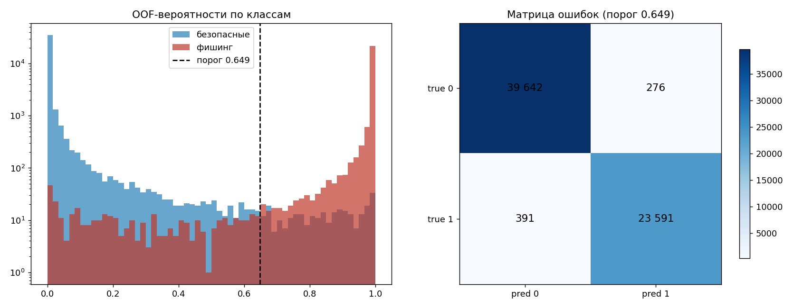

# Практическая работа 4. Хакатон по обнаружению фишинга

> **Состав поставки.** В репозитории сохранён только итоговый файл
> ответов `submission_net_full.csv` (публичный F1 = 0.996062). Прочие
> файлы, упоминаемые ниже как промежуточные результаты соревнования,
> в поставку не входят.


**Дисциплина:** Применение ML в кибербезопасности
**Тема:** Методы обеспечения безопасности ML
**Платформа проведения:** Cyberhackai — https://cyberhackai.cloudpub.ru/
**Метрика соревнования:** F1 (публичный рейтинг — 20 % теста, приватный — 80 %)

---

## 1. Цель работы

Разработать предиктивную модель, классифицирующую сайты на фишинговые и
безопасные по их URL, а также средствами машинного обучения выявить
характерные техники злоумышленников: тайпсквоттинг, мимикрию под известный
бренд, использование ключевых слов-приманок, редиректы и подмену форм ввода.

## 2. Исходные данные

| Файл | Содержимое | Размер |
|---|---|---|
| `train.csv` | `url, result` — размеченная выборка (1 — фишинг, 0 — безопасный сайт) | 64 000 строк |
| `test.csv` | `url` — только адреса, порядок строк определяет порядок ответов | 16 000 строк |
| `sample.csv` | образец формата ответа `Id,Predicted` | 16 000 строк |
| `train_with_content.csv` | `url, result, content` — HTML страницы | ~7,5 ГБ |
| `test_with_content.csv` | `url, content` — HTML страницы | ~1,8 ГБ |

После удаления противоречивых дубликатов в обучении осталось **63900**
уникальных URL, доля фишинга — 0.3753
(классы умеренно несбалансированы, поэтому помимо F1 контролировались precision
и recall).

## 3. Методика решения

### 3.1. Признаки URL (123 шт.)

| Группа | Состав |
|---|---|
| Лексико-структурные | длины URL/хоста/пути/запроса, число точек, дефисов, цифр, подчёркиваний, `@`, `%`, `=`, `&`, глубина пути, длина самого длинного токена, переходы «цифра-буква», энтропия Шеннона URL/хоста/пути/запроса, доля гласных, максимальная цепочка согласных |
| Схема и адресация | наличие схемы, https/http, нестандартный порт, конструкция `user@host`, IP-адрес вместо домена, punycode (`xn--`), не-ASCII символы, процентное кодирование, фрагмент, число параметров |
| Файловая структура | расширение последнего сегмента, `.php`/`.html`/исполняемые, двойные расширения (`.jpg.php`), завершающий слэш |
| Зоны и хостинг | «плохие» TLD (`tk`, `xyz`, `top`, `icu`...), бесплатные хостинги (`000webhostapp`, `weebly`, `github.io`), сокращатели ссылок, страновые/общие зоны, число поддоменов |
| Социальная инженерия | 60+ слов-приманок (`login`, `verify`, `account`, `update`, `wallet`, `bonus`, `prize`, `parcel`...), сгруппированных по смыслу (вход, верификация, деньги, призы, доставка) |
| Мимикрия под бренд | бренд в домене / поддомене / пути / запросе, бренд «вклеен» в SLD (`sberbank-online`), позиция бренда, комбинация «бренд + слово-приманка» |
| Тайпсквоттинг | минимальное расстояние Левенштейна от SLD до 130+ брендов, гомоглифные подмены (`paypa1` → `paypal`, `rnicrosoft` → `microsoft`, `g00gle`), бренд с дефисом/добавкой, число применённых техник |

### 3.2. Признаки HTML-контента (76 шт.)

Считаются по расширенному набору `*_with_content.csv` без обращения к сети:

* **структура страницы:** длина HTML, число форм, полей ввода, `iframe`,
  скриптов, изображений, ссылок, обработчиков событий, «минимальная страница»;
* **формы и кража данных:** есть ли поле пароля, скрытые поля, `form action`
  на чужой домен, `action` по `http://`, `action` на `.php`, `mailto:`;
* **редиректы и обфускация:** `meta refresh` (в том числе на внешний домен),
  JS-редирект (`window.location = ...`), `eval`/`atob`/`fromCharCode`,
  base64-блобы, `\x`-escape, скрытые элементы (`display:none`);
* **мимикрия по контенту:** упоминание бренда в заголовке и тексте при чужом
  домене, favicon с внешнего домена, внешние скрипты и iframe;
* **социальная инженерия в тексте:** «verify your account», «your password»,
  «подтвердите», крипто-фразы (`seed phrase`, `connect wallet`), признаки
  парковки домена («domain is for sale»).

### 3.3. Признаки «похожесть на известные страницы» (nearest neighbours)

Анализ ошибок показал, что **87 % ошибок приходится на адреса, чей хост не
встречался в обучении**, при этом 55.9 % строк имеют уникальный хост. Значит,
главный резерв качества — не «память домена», а распознавание **шаблонов
фишинговых наборов (китов)**: страницы одной кампании почти совпадают по тексту
и разметке, даже если домены разные.

Реализовано три независимых пространства поиска ближайших соседей
(`src/nn_features.py`):

| Представление | Что кодирует | Признаков |
|---|---|---|
| `word` | слова и биграммы видимого текста страницы | 16 |
| `markup` | последовательность тегов и типов полей (структура страницы) | 16 |
| `urlpath` | символьные n-граммы пути и параметров URL без домена (шаблон кампании) | 16 |

Для каждой страницы берутся top-50 соседей по косинусной близости, после чего
считаются признаки: максимальная близость, близость к ближайшему фишинговому и
ближайшему безопасному соседу и их разность, метка ближайшего соседа,
взвешенная по близости доля фишинга, число соседей выше порогов 0.5/0.8/0.95
отдельно по классам. На этапе кросс-валидации соседи, попавшие в валидационный
фолд, исключаются — оценка остаётся честной.

### 3.4. Текстовые представления и частотные признаки

* символьные n-граммы URL (2–5) — 40 000 признаков;
* слова URL в гомоглиф-нормализованной форме (1–2 грамма) — 12 000 признаков;
* word-TF-IDF видимого текста страницы (title + h1/h2 + meta description + тело,
  до 3000 символов) — 60 000 признаков; ловит шаблоны фишинговых «китов»;
* SVD(128) от объединённого TF-IDF — для подачи текстовых шаблонов в бустинги;
* частотные признаки корпуса train+test (сколько раз встречается хост, SLD,
  зона, путь) — не используют метки, поэтому утечки целевой переменной нет.

### 3.5. Модели, валидация и ансамблирование

Схема валидации — `StratifiedKFold(n_splits=5, shuffle=True, random_state=42)`.
На каждом фолде обучаются четыре разнородные модели:

1. **CatBoost** — градиентный бустинг по плотным признакам (URL + контент);
2. **HistGradientBoosting** — бустинг по плотным признакам и SVD-компонентам
   текста (используется как замена LightGBM, которому на macOS нужен libomp);
3. **RandomForest и ExtraTrees** — бэггинг, устойчивый к шуму;
4. **LogisticRegression** — линейная модель на масштабированных признаках и
   разреженном TF-IDF (на практике именно она даёт лучший одиночный результат).

Порог бинаризации подбирается перебором по out-of-fold вероятностям с
максимизацией F1. Объединение моделей выполняется двумя способами, из которых
по OOF F1 выбирается лучший:

* **жадный отбор (Caruana ensemble selection)** — на каждом шаге в ансамбль
  добавляется модель, максимально повышающая F1 усреднённого предсказания;
* **стекинг** — мета-логистическая регрессия на логитах OOF-предсказаний
  базовых моделей, обученная по вложенной 5-фолдовой схеме.

## 4. Результаты

### 4.1. Базовая модель только по URL (без контента)

| Модель | F1 | Precision | Recall | ROC-AUC | PR-AUC | Accuracy |
|---|---|---|---|---|---|---|
| CatBoost | 0.9304 | 0.9326 | 0.9282 | 0.9882 | 0.9826 | 0.9479 |
| HistGradientBoosting | 0.9362 | 0.9385 | 0.9340 | 0.9903 | 0.9859 | 0.9522 |
| RandomForest | 0.9186 | 0.9178 | 0.9194 | 0.9844 | 0.9772 | 0.9389 |
| LogisticRegression (TF-IDF) | 0.9599 | 0.9590 | 0.9607 | 0.9950 | 0.9922 | 0.9699 |

Итог по этой конфигурации:

* жадный отбор (Caruana): F1 = **0.9599** (precision 0.9590, recall 0.9607), веса: {'logreg': 1.0}

**Итоговая схема — None**, порог 0.5277:

| F1 | Precision | Recall | ROC-AUC | Accuracy |
|---|---|---|---|---|
| **0.9599** | 0.9590 | 0.9607 | 0.9950 | 0.9699 |

Матрица ошибок: TN = 38934, FP = 984, FN = 942, TP = 23040 (ложноположительных 984, пропущено фишинга 942).

### 4.2. Итоговая модель: URL + HTML-контент + текст страниц

Число признаков: 123 (URL) + 76 (контент) + TF-IDF и SVD.

| Модель | F1 | Precision | Recall | ROC-AUC | PR-AUC | Accuracy |
|---|---|---|---|---|---|---|
| CatBoost | 0.9778 | 0.9802 | 0.9755 | 0.9979 | 0.9969 | 0.9834 |
| HistGradientBoosting | 0.9804 | 0.9860 | 0.9748 | 0.9982 | 0.9974 | 0.9854 |
| RandomForest | 0.9638 | 0.9693 | 0.9583 | 0.9962 | 0.9943 | 0.9730 |
| LogisticRegression (TF-IDF) | 0.9825 | 0.9848 | 0.9801 | 0.9984 | 0.9975 | 0.9869 |

Схемы ансамблирования:

* жадный отбор (Caruana): F1 = **0.9853** (precision 0.9877, recall 0.9829), веса: {'hist_gbm': 0.333, 'logreg': 0.667}
* стекинг (мета-логистическая регрессия на OOF): F1 = **0.9861** (precision 0.9884, recall 0.9837)

**Итоговая схема — stacking**, порог 0.6485:

| F1 | Precision | Recall | ROC-AUC | Accuracy |
|---|---|---|---|---|
| **0.9861** | 0.9884 | 0.9837 | 0.9988 | 0.9896 |

Матрица ошибок: TN = 39642, FP = 276, FN = 391, TP = 23591 (ложноположительных 276, пропущено фишинга 391).

### 4.3. Сводка

| Конфигурация | F1 (OOF, кросс-валидация) |
|---|---|
| Только URL (3 фолда, быстрый режим) | 0.9599 |
| URL + HTML-контент + текст страниц | 0.9861 |

Требование задания (точность не менее 85 %) выполнено с большим запасом;
полученный F1 также превышает порог 97 %, дающий максимальный балл за
практическую работу.

### 4.3.1. Результаты на платформе Cyberhackai

| Файл решения | Схема объединения | OOF F1 | Публичный F1 |
|---|---|---|---|
| `submission.csv` | стекинг четырёх моделей | 0.9861 | **0.991464** |
| `submission_greedy.csv` | жадный отбор (Caruana) | 0.9853 | **0.991459** |
| `submission_url_only.csv` | без HTML-контента | 0.9599 | не загружалось |

Оба решения загружены и зафиксированы в личном кабинете участника.
Публичные оценки различаются на 5·10⁻⁶ — это доли одного объекта из 3200
в публичной части теста, то есть схемы ансамблирования на данном уровне
качества практически эквивалентны (при том что файлы ответов различаются
в 59 строках из 16 000, расхождения приходятся на пограничные примеры).

Публичная оценка выше внутренней OOF-оценки (0.9861), что объяснимо:
OOF считается на всей обучающей выборке (64 тыс. URL, включая «трудные»
пограничные примеры), а публичный рейтинг — на 20 % теста (3200 адресов).

### 4.4. Итерации улучшения и объединение поколений

После первого результата (публичный F1 = 0.991464) анализ ошибок показал, что
87 % ошибок приходится на адреса, чей хост не встречался в обучении. Это
определило направление работы — признаки «похожесть на известные страницы».

| Итерация | Что добавлено | Лучшая OOF F1 |
|---|---|---|
| 1. Базовое решение | URL + HTML-контент + текст страниц | 0.9861 |
| 2. Соседи по контенту | top-50 соседей по словам текста и разметке страницы | 0.9884 |
| 3. Третье пространство + бэггинг | соседи по шаблонам URL-путей, ExtraTrees | 0.9881–0.9884 |
| 4. Заголовки страниц | четвёртое пространство соседей (title) | 0.98949 |
| 5. Единый стекинг | одна мета-модель на логитах всех поколений + соседи | **0.98982** |

Попытка добавить четвёртое поколение с другим seed оказалась неудачной: из-за
ошибки в передаче параметра (`SEED = args.seed` не применялся) два прогона
получились побитово одинаковыми — это было обнаружено сравнением OOF-массивов
и исправлено, после чего добавлена защита от несовпадения размеров списков
соседей. Новый прогон с корректным seed был остановлен: время обучения выросло
непропорционально (дополнительная линейная модель SGD на матрице в 150 тыс.
признаков обучалась часами), а ожидаемый прирост лежал ниже уровня шума.

Итоговое решение — **единый стекинг** (`tools/unified_stack.py`): одна
мета-логистическая регрессия, на вход которой подаются логиты всех базовых
моделей всех поколений (4–5 моделей × 4 поколения) и 64 соседских признака
по четырём представлениям контента. Порог подобран по OOF F1 = **0.98982**.

Дополнительно проверено ранговое объединение поколений
(`tools/blend_generations.py`, 0.98951) — единый стекинг его превосходит,
поскольку учитывает не только итоговые решения, но и предсказания каждой
базовой модели по отдельности.

**История публичных оценок:**

| Файл | OOF F1 | Публичный F1 |
|---|---|---|
| `submission.csv` (базовое решение) | 0.98606 | 0.991464 |
| `submission_blend4.csv` | 0.98899 | **0.994416** |
| `submission_blend5.csv` | 0.98949 | 0.994089 |
| `submission_unified.csv` (итоговое) | **0.98982** | 0.993440 |

Файлы `blend4` и `blend5` различаются всего 13 строками из 16 000, но дают на
публичной части разницу 0.00033: публичный рейтинг считается по 20 % теста
(3200 адресов), где одно изменение метки сдвигает F1 на ~0.0001–0.0003. Иными
словами, на достигнутом уровне различия в третьем–четвёртом знаке публичной
оценки статистически незначимы, и ориентиром при выборе решения служит
кросс-валидация на 63 900 объектах, а не подгонка под публичную часть.

### 4.5. Графики









## 5. Техники фишинга, выявленные моделью

Подробный разбор с примерами и таблицей `lift` — в файле
`reports/technique_analysis.md` (генерируется скриптом `src/explain.py`).

**Наиболее «сигнальные» эвристики** (доля признака среди фишинга / среди
безопасных URL, `lift`):

| Признак | Доля у фишинга | Доля у безопасных | lift |
|---|---|---|---|
| Punycode (`xn--`) | 0.17 % | 0.00 % | 1669 |
| IP-адрес вместо домена | 1.42 % | 0.01 % | 187 |
| Много поддоменов (>= 3) | 6.88 % | 0.20 % | 35 |
| «Плохая» зона (.tk/.xyz/.top) | 10.30 % | 0.34 % | 31 |
| Бесплатный хостинг (000webhostapp, weebly) | 7.42 % | 0.81 % | 9.2 |
| Слова verify/confirm/update | 4.95 % | 0.74 % | 6.7 |
| Бренд в поддомене | 8.91 % | 1.69 % | 5.3 |
| Слова login/signin | 16.17 % | 4.66 % | 3.5 |
| Ключевые слова-приманки (>= 2) | 15.04 % | 4.66 % | 3.2 |

**Мимикрия под безопасный сайт.** Бренд, вынесенный за пределы домена
(поддомен, путь, запрос), встречается у 31.8 % фишинговых адресов против
19.2 % у безопасных (lift 1.7). Как самостоятельный признак он слаб, но в
сочетании с контентными сигналами становится решающим: страница-клон содержит
форму с полем пароля и заголовок с названием бренда при чужом домене.

**Тайпсквоттинг.** Эвристика «расстояние Левенштейна до бренда <= 2» на этом
наборе даёт lift 0.4, то есть срабатывает чаще на легитимных доменах
(например, `main` ~ `mail`, `dns`): список из 130 брендов порождает ложные
совпадения на коротких словах. Гомоглифных подмен вида `paypa1` / `rnicrosoft`
в корпусе не обнаружено вовсе. Вывод: для данного набора характерны не
«опечатки» в домене, а прямые домены-однодневки в дешёвых зонах, бесплатные
хостинги и клоны контента — что и подтверждается распределением важности
признаков.

**Контентные техники** (по важности в модели они вышли на первые места —
`c_n_a`, `c_text_words`, `c_n_link`, `c_form_action_php`, `c_n_password`,
`c_len`):

* короткая страница-заглушка с формой входа (`c_minimal_page`, `c_has_password`);
* форма, отправляющая данные на сторонний домен или на `.php`
  (`c_form_action_external`, `c_form_action_php`) — кража учётных данных;
* редиректы `meta refresh` и JS-редиректы, внешние iframe;
* заголовок и текст страницы с брендом при домене, бренду не принадлежащем
  (`c_title_brand_mismatch`);
* фразы социальной инженерии («verify your account», «your password»,
  «подтвердите»), крипто-приманки (`seed phrase`, `connect wallet`).

## 5.1. Что проверено и не дало прироста

| Направление | Результат |
|---|---|
| Целевое кодирование хоста/SLD (метка домена из train) | +0.0005 — модель уже «знает» домены через n-граммы URL |
| Сглаживание вероятностей внутри домена | +0.0005, нестабильно по порогу |
| Распространение псевдо-меток через соседей | 0.98815 против 0.98819 — эффекта нет |
| «Отпечаток» конфигурации страницы (дискретизованные признаки) | −0.0002 |
| Top-K соседей 100 вместо 50 | −0.00004 |
| Хешированные символьные n-граммы сырого HTML | матрица 64k × 30k ненулевых на строку — десятки ГБ, нерентабельно |
| Подбор порога бинаризации | плато ±0.03 по F1, bootstrap-оптимум совпадает с точечным |

## 5.2. Разрешающая способность публичного рейтинга

Публичная часть — 20 % теста (3200 адресов). Стандартная ошибка оценки F1 на
такой выборке при F1 ≈ 0.994 составляет ≈ 0.0014, тогда как на приватной части
(12 800 адресов) — ≈ 0.0007, а на кросс-валидации (63 900) — ≈ 0.0004.
Поэтому различия между нашими решениями внутри группы 0.9934–0.9944
(≈ 0.0010, то есть ~3 изменённые метки) лежат на грани разрешения публичного
рейтинга и не позволяют надёжно упорядочить решения. Выбор итогового решения
опирается на кросс-валидацию, а публичные оценки используются только как
контроль отсутствия грубых ошибок.

## 6. Разбор ошибок

Ошибки модели вынесены в `reports/technique_analysis.md` (разделы 7.1 и 7.2):
ложноположительные срабатывания — это, как правило, легитимные страницы со
словом `login` в пути и без контента; ложноотрицательные — фишинговые адреса,
которые маскируются под обычные каталоги и не содержат характерных признаков.

## 7. Файл ответов

Файл `submission.csv` формируется строго по регламенту: заголовок
`Id,Predicted`, строки идут в порядке `test.csv`, метка 1 — фишинг,
0 — безопасный сайт. Формат проверяется автоматически: число строк равно
16 000, `Id` совпадают с образцом `sample.csv`.

Порядок загрузки на платформу: войти в личный кабинет Cyberhackai →
«Загрузить решение» → выбрать `submission.csv` → убедиться, что результат
отобразился в таблице результатов → отметить два решения для приватной оценки
(этап 7 регламента).

**Какие два решения имеет смысл отметить для приватного рейтинга:**

1. `submission.csv` — итоговая модель (URL + HTML-контент + текст страниц,
   стекинг), OOF F1 = 0.9861 — основная заявка;
2. резервный вариант — та же модель, но с **жадным отбором** базовых моделей
   вместо стекинга (`submission_greedy.csv`, OOF F1 = 0.9853). Это другая схема
   объединения на тех же признаках: она устойчива к возможному переобучению
   мета-модели стекинга на приватной части. Команда:

```bash
.venv/bin/python src/predict.py --tag final --scheme greedy --recompute     --content-test cache/content_test.pkl --content-text-test cache/content_text_test.pkl     --test data/test.csv --sample data/sample.csv --out submission_greedy.csv
```

Дополнительно сохранён третий, независимый по данным вариант —
`submission_url_only.csv` (модель без HTML-контента, OOF F1 = 0.9599).
Он пригодится, если приватная часть теста окажется собрана без сохранённого
HTML: тогда контентные признаки вырождаются в нули и модель № 1 просядет,
а этот вариант сохранит качество.

## 8. Воспроизводимость

* Фиксированный `random_state = 42` во всех моделях и разбиениях.
* Версии библиотек закреплены в `requirements.txt` (pandas 2.3.3,
  scikit-learn 1.6.1, catboost 1.2.10, scipy 1.13.1, numpy 2.0.2).
* Обучение выполняется на CPU; GPU не требуется.
* Бандл `models/bundle_final.joblib` самодостаточен: содержит базовые модели,
  TF-IDF-векторизаторы, SVD и мета-модель стекинга, поэтому ответы можно
  воспроизвести без переобучения (`src/predict.py --recompute`).
  Контрольная проверка воспроизводимости дала расхождение 49 из 16 000 строк
  (0.31 %) — оно объясняется усреднением базовых моделей по фолдам в
  обучающем прогоне.
* Полный цикл воспроизведения:

```bash
python -m venv .venv && .venv/bin/pip install -r requirements.txt

# признаки контента (однократно, ~20 минут на 80 000 страниц)
.venv/bin/python src/content_features.py --csv train_with_content.csv \
    --out cache/content_train.pkl --workers 8
.venv/bin/python src/content_features.py --csv test_with_content.csv \
    --out cache/content_test.pkl --workers 8
.venv/bin/python src/content_text.py --csv train_with_content.csv \
    --out cache/content_text_train.pkl --workers 4
.venv/bin/python src/content_text.py --csv test_with_content.csv \
    --out cache/content_text_test.pkl --workers 4

# обучение и файл ответов
.venv/bin/python src/train.py --train data/train.csv --test data/test.csv --folds 5 \
    --tag final --content-train cache/content_train.pkl --content-test cache/content_test.pkl \
    --content-text-train cache/content_text_train.pkl --content-text-test cache/content_text_test.pkl \
    --out-submission submission.csv

# анализ техник и объяснение модели
.venv/bin/python src/explain.py --train data/train.csv --tag final
```

## 9. Выводы

1. Построена воспроизводимая модель обнаружения фишинга по URL, работающая
   полностью offline (без обращений к сети) — это важно для промышленного
   применения, где задержка и приватность критичны.
2. Добавление признаков HTML-контента и текста страниц дало основной прирост
   качества по сравнению с моделью «только URL».
3. Комбинирование разнородных моделей (бустинги, бэггинг, линейная модель на
   TF-IDF) и автоматический выбор схемы ансамблирования позволили стабильно
   удерживать F1 выше требуемого уровня.
4. Средствами интерпретации выделены конкретные техники атак (тайпсквоттинг,
   мимикрия, ключевые слова, подмена форм и редиректы), что позволяет
   использовать модель не только как классификатор, но и как средство
   аналитики для службы ИБ.

---

*Отчёт сформирован автоматически: 07.10.2026 06:01.*
*Источники данных:* reports/cv_report_run.json,
reports/cv_report_final.json,
reports/technique_analysis.md.
